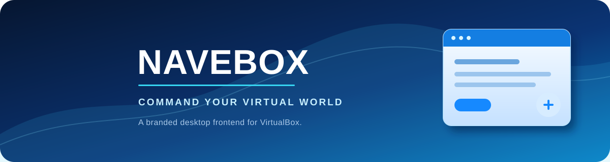

<p align="center">
  
</p>

<p align="center">
  <strong>A focused desktop experience for managing virtual machines and Android virtual phones.</strong>
</p>

<p align="center">
  <a href="https://github.com/sonicific/navebox/actions/workflows/navebox-checks.yml">
    
  </a>
  <a href="https://github.com/sonicific/navebox">
    
  </a>
  <a href="https://www.virtualbox.org/">
    
  </a>
</p>

## Overview

Navebox is a branded desktop frontend built from the VirtualBox source tree. It
provides a polished Navebox identity while preserving the underlying VirtualBox
API, service and VM-file identifiers needed for compatibility.

The project combines two workflows in one manager:

- **Machines** - create, configure, start, pause and manage VirtualBox virtual
  machines.
- **Phones** - create and manage Android virtual phones backed by an installed
  Android SDK and Android Emulator.

Navebox is currently focused on the Windows desktop frontend. Other host
platforms supported by the underlying VirtualBox tree require their own build,
packaging and runtime qualification.

> **Development status:** this repository is a development checkout, not a
> prebuilt binary download or a qualified production release. See the
> [release and validation guide](doc/navebox-release.md) before distributing
> artifacts.

## Highlights

- Distinct Navebox branding, icons, artwork and Windows taskbar identity.
- Familiar VirtualBox machine management and compatibility behavior.
- Android phone management from **File > Android Phones**.
- Light, dark and high-DPI-aware interface behavior.
- Existing VirtualBox translation and accessibility infrastructure.
- Automated checks for branding, packaging, dialogs and GUI state.
- Structured Windows release stages with manifests and SHA256 checksums.

## Contents

- [Quick start](#quick-start)
- [Build the tree](#build-the-tree)
- [Test](#test)
- [Android virtual phones](#android-virtual-phones)
- [Branding and icons](#branding-and-icons)
- [Project documentation](#project-documentation)
- [Contributing](#contributing)
- [Security](#security)
- [License](#license)

## Quick start

### Prerequisites

VirtualBox requires a platform-specific compiler, SDKs, Qt and additional
dependencies. Start with the official
[VirtualBox build instructions](https://www.virtualbox.org/wiki/Build_instructions),
then use this repository's external developer setup:

```text
configure.py
```

Keep machine-local settings in `LocalConfig.kmk`. Internal developers should
use the environment scripts described in the
[release and validation guide](doc/navebox-release.md). Prefer `KBUILD_*`
variables and keep release builds in a separate output tree.

### Build the tree

In a prepared developer shell:

```text
kmk
```

For the supported Windows x64 workflow, use the repository entry point:

```text
.\build.cmd doctor
.\build.cmd check
.\build.cmd release
```

Run `.\build.cmd --help` for the available stages. The `release` pipeline
compiles the required components, stages Qt, creates and verifies MSI/EXE
artifacts, and writes delivery files to:

```text
out/win.amd64/release/delivery
```

For a new checkout, copy `navebox-build.example.json` to
`navebox-build.local.json`, then prepare
`LocalConfig.release.kmk` from
`tools/navebox/LocalConfig.release.example.kmk`. Configure actual SDK, Qt,
WiX, compiler and signing paths locally. These files are ignored and must not
contain credentials committed to the repository.

> `build.cmd` does not install Navebox, register COM/services/drivers, download
> dependencies, create certificates or change Windows security settings.

## Test

Run the dependency-free packaging and catalog checks from the repository root:

```text
python src/VBox/Frontends/VirtualBox/testcase/tstNaveboxPackaging.py
```

In a configured build environment, compile and run the GUI regression test:

```text
kmk -C src/VBox/Frontends/VirtualBox VBOX_WITH_TESTCASES=1 tstNaveboxGui
out/<host>.<arch>/<build-type>/bin/testcase/tstNaveboxGui
```

Append `.exe` to the test executable on Windows. The test documentation covers
Qt offscreen execution, snapshot export and native-platform checks:
[frontend regression checks](src/VBox/Frontends/VirtualBox/testcase/README.md).

Automated tests do not replace native Windows accessibility and DPI checks,
installer testing, driver-signing validation or VM compatibility testing.

## Android virtual phones

The **Phones** page is available beside **Machines** in the main navigation.
Phones use Android Emulator independently of VirtualBox VMs; emulator windows
provide their own touch, rotation, volume, camera and device controls.

Install a standalone Android SDK or Android Studio's SDK components, including:

- Android Emulator
- Android SDK Platform-Tools
- Android SDK Command-Line Tools (latest)
- A stable phone system image for API 26 or newer

In Navebox, open **SDK Settings**, select the SDK directory and a compatible
Java home, then click **Apply SDK** and **Check Acceleration**. Navebox uses
installed SDK components; it does not download packages, accept licenses,
enable Windows features or change firmware/security settings.

For complete setup, creation, lifecycle, troubleshooting and data-location
details, read the [Android virtual phones guide](doc/navebox-phones.md).

## Branding and icons

The editable source artwork is
[`navebox.svg`](src/VBox/Frontends/VirtualBox/images/Navebox/navebox.svg).
Generated PNG and ICO sizes are consumed by the application and installer; do
not edit individual exported resolutions.

Regenerate branding with the Qt-based
[`render-navebox-branding.cpp`](src/VBox/Frontends/VirtualBox/scripts/render-navebox-branding.cpp)
utility. Follow the [asset instructions](src/VBox/Frontends/VirtualBox/images/Navebox/README.md)
for required Qt libraries and commands.

## Deployment and compatibility

Navebox is not a portable single executable. Do not copy `Navebox.exe` by
itself and treat it as a complete installation. Normal deployment requires the
matching frontend and backend binaries, COM registration, VBoxSDS service, Qt
runtime/plugins and the feature payloads selected by the installer.

Use a complete, tested installer and qualify it on a clean host. Record the
source revision, toolchain, configuration, artifact checksums and test evidence
for every release candidate. Build provenance, supported execution backends,
packaging requirements and acceptance gates are documented in the
[release and validation guide](doc/navebox-release.md).

## Project documentation

- [Release and validation guide](doc/navebox-release.md) - build provenance,
  Windows packaging, deployment and acceptance gates.
- [Android virtual phones](doc/navebox-phones.md) - SDK setup and phone
  lifecycle.
- [Frontend regression checks](src/VBox/Frontends/VirtualBox/testcase/README.md)
  - automated packaging and GUI test instructions.
- [VirtualBox User Guide](https://docs.oracle.com/en/virtualization/virtualbox/index.html)
  - user-facing VM configuration and product documentation.
- [VirtualBox technical documentation](https://www.virtualbox.org/wiki/Technical_documentation)
  - architecture and developer references.

## Contributing

Bug reports and feature requests are welcome through the
[issue tracker](https://github.com/sonicific/navebox/issues). Before opening an
issue, check whether it may be a security vulnerability.

For code contributions, read [CONTRIBUTING.md](CONTRIBUTING.md). Keep changes
focused, update related documentation and include the narrowest useful
validation evidence. Do not commit generated build outputs, local
configuration files, VM images, logs or credentials.

## Security

Treat guest-controlled, network-controlled, disk-controlled and user-supplied
input as untrusted. Report suspected vulnerabilities privately according to the
[security policy](SECURITY.md) and the
[upstream vulnerability reporting guide](https://www.oracle.com/corporate/security-practices/assurance/vulnerability/reporting.html).
Do not disclose suspected vulnerabilities through public issues.

## License

Navebox follows the licensing terms of the VirtualBox source tree. The main
program is released under the [GNU General Public License v3.0](COPYING).
Additional components may use other licenses; see
[COPYING.CDDL](COPYING.CDDL), [COPYING.LIB](COPYING.LIB) and
[THIRD_PARTY_LICENSES.txt](THIRD_PARTY_LICENSES.txt).

Copyright notices and third-party license terms remain applicable to the
corresponding source files and distributed components.
